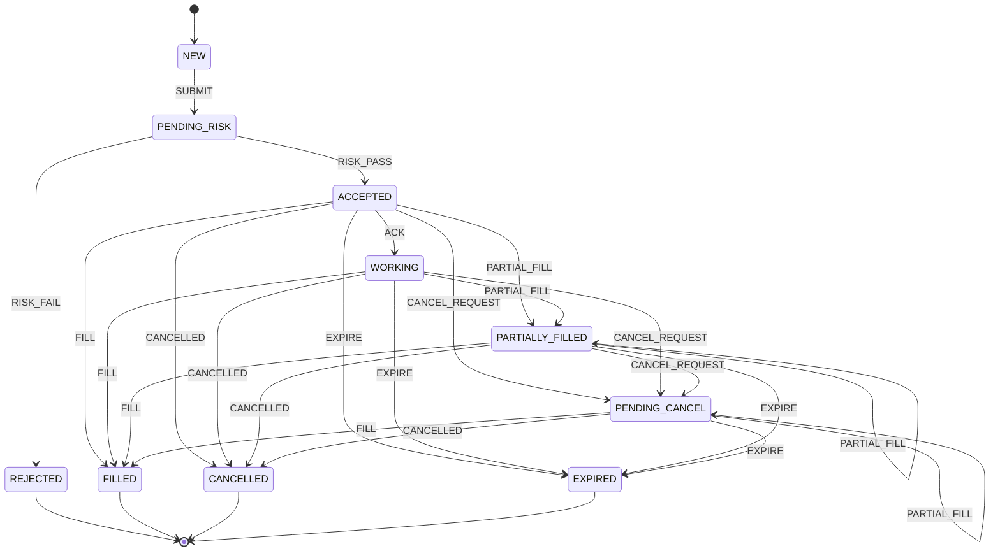

# Order lifecycle

The table lives in `src/config/orderStates.js` and `transition(state, event)` is the only way an order changes state. Every handler goes through it, inserts an `order_events` row, and updates with `WHERE id = $2 AND status = $3` so a concurrent writer loses with a 409.

## Diagram

## States

| State | Meaning |
|---|---|
| NEW | Row created, nothing checked yet. |
| PENDING_RISK | Pre-trade risk checks are running. |
| REJECTED | A risk check failed. `reject_reason` holds the message. Terminal. |
| ACCEPTED | Risk passed and the hold is in place. Not yet acknowledged by the exchange. |
| WORKING | The exchange acknowledged it and it is resting or being matched. |
| PARTIALLY_FILLED | Some quantity has traded, the rest is still open. |
| FILLED | All quantity traded. Terminal. |
| PENDING_CANCEL | A cancel was requested and the exchange has not confirmed. Fills can still arrive. |
| CANCELLED | Removed with its unfilled part. Fills it already had stay. Terminal. |
| EXPIRED | A DAY order removed at the end of the session. Terminal. |

## Events

| Event | Sent by |
|---|---|
| SUBMIT | the order intake handler, right after the row is created |
| RISK_PASS, RISK_FAIL | the pre-trade risk checks |
| ACK | the router, when the exchange acknowledges the order |
| PARTIAL_FILL, FILL | fill handling, after a trade is booked |
| CANCEL_REQUEST | the cancel handler |
| CANCELLED | the exchange, when it confirms a cancel or cancels on its own (market order with no liquidity, IOC remainder, self-trade prevention) |
| EXPIRE | the end-of-session sweep |

()=>`## How the handlers use it

- **Intake** (\`POST /orders\`): the order row is created NEW and SUBMIT moves it to PENDING_RISK. \`vet()\` in \`src/config/risk.js\` runs the checks in this order: Market closed, Instrument halted, Invalid lot size, Invalid tick size, Quantity too large, Order value too large, Price outside allowed band, Insufficient balance, Insufficient shares. The first failure is stored with RISK_FAIL, \`reject_reason\` is set and the answer is 400 \`{ error, orderId }\`. Otherwise RISK_PASS and the hold are written in the same transaction. A rejected order keeps its idempotency key.
- **Cancel** (\`DELETE /orders/:id\`): the order row is locked, CANCEL_REQUEST is saved and committed, the exchange is asked, and only when it confirms does a second transaction set CANCELLED and release the hold. If the exchange says the order was no longer resting, the order stays PENDING_CANCEL, the answer is 409 "Order already filled", and the fill that is on its way moves it to FILLED.
- **Replace** (\`PATCH /orders/:id\`): changes quantity or price of a resting limit order and is not a state change, so it writes no event. The checks run again on the new values, funds are counted on the unfilled part with the order's own hold counted as free, the hold is resized, and the exchange is told before the commit. If the exchange refuses, everything rolls back.
- Every status change goes through \`moveOrder\`, which runs \`transition()\` and updates with \`WHERE id = $2 AND status = $3\`. Zero rows means another request moved the order first.

## Notes
`
- ACCEPTED can go straight to FILLED, CANCELLED or EXPIRED. A market order or an IOC order can finish inside the same exchange call that acknowledges it, so the router never has to pass through WORKING. Task 5.3 relies on this: an accepted order ends as WORKING or terminal, never stuck in ACCEPTED.
- PENDING_CANCEL stays PENDING_CANCEL on a partial fill, and moves to FILLED if the fill completes the order. This is the cancel-versus-fill race from task 4.5: the cancel handler answers 409 "Order already filled" when it finds the order FILLED.
- There is no way back from a terminal state. `transition` throws on any event for REJECTED, FILLED, CANCELLED or EXPIRED.
- The statuses in the `orders` CHECK constraint are exactly the ten states above.
