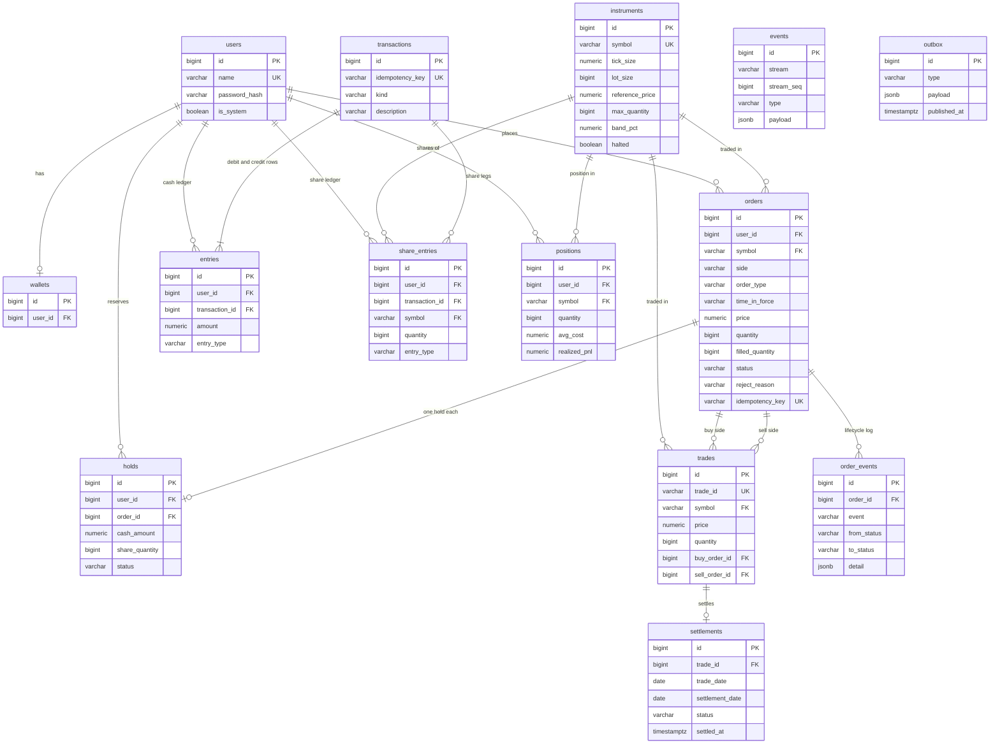

# Database schema v1

One `.sql` file per table in `src/models`. `node scripts/initDb.js` builds an empty database in dependency order inside one transaction, so a failure leaves nothing half built. `node scripts/initDb.js --reset` drops the `public` schema first, and it is meant for development databases only.

## ER diagram

`events` and `outbox` have no foreign keys on purpose. `events` is the append-only command log keyed by stream (the symbol), and `outbox` is a queue of messages to publish. Both must stay writable on their own.

## Tables

| Table | Job | Phase that fills it |
|---|---|---|
| users | Traders, bots and the system accounts (`deposits`, `exchange`, `fees`). | 3 |
| wallets | One row per user that can hold cash. | 3 |
| instruments | The tradable symbols with tick size, lot size, reference price and limits. | 7 (seed), read from 4 |
| orders | Every order and its current status. | 4 |
| order_events | One row per status change, the order's lifecycle log. | 4 |
| trades | One row per match, `trade_id` unique so a repeat is detected. | 5 |
| transactions | Header of each ledger posting: DEPOSIT, TRADE or FEE. | 3 |
| entries | Cash legs, a DEBIT and a CREDIT per transaction. Balances are derived with `SUM(CASE ...)`. | 3 |
| share_entries | The same for shares. | 3 |
| holds | One reservation per order. Available cash is balance minus active holds. | 3 and 4 |
| positions | Quantity, average cost and realised P&L per user and symbol. | 3 and 5 |
| settlements | One row per trade, PENDING until the settlement date. | 5 |
| events | Append-only command log, a global id plus a per-symbol sequence. | 6 |
| outbox | Messages written with each state change and published later. | 6 |

## Rules every table follows

- `id BIGINT GENERATED ALWAYS AS IDENTITY PRIMARY KEY`.
- Foreign keys are inline and the types match on both sides.
- Fixed sets use `CHECK (col IN (...))`, quantities use `CHECK (quantity > 0)`, and money is `NUMERIC(12,2)` (ADR 0001).
- Every idempotency column has a unique key: `orders.idempotency_key`, `transactions.idempotency_key`, `trades.trade_id` and `events (stream, stream_seq)`. `settlements.trade_id` and `holds.order_id` are unique so a repeat cannot create a second row.
- Indexes: `orders (symbol, status)`, `entries (user_id)`, plus the lookups the later phases hit (see the model files).

## Added later

The triggers that block UPDATE and DELETE on `entries` and `share_entries` come with task 3.2, and the ones on `events` with task 6.1. `book_snapshots` (6.3) and `candles` (7.4) are new tables in those phases.
